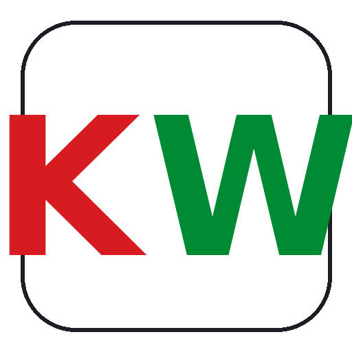
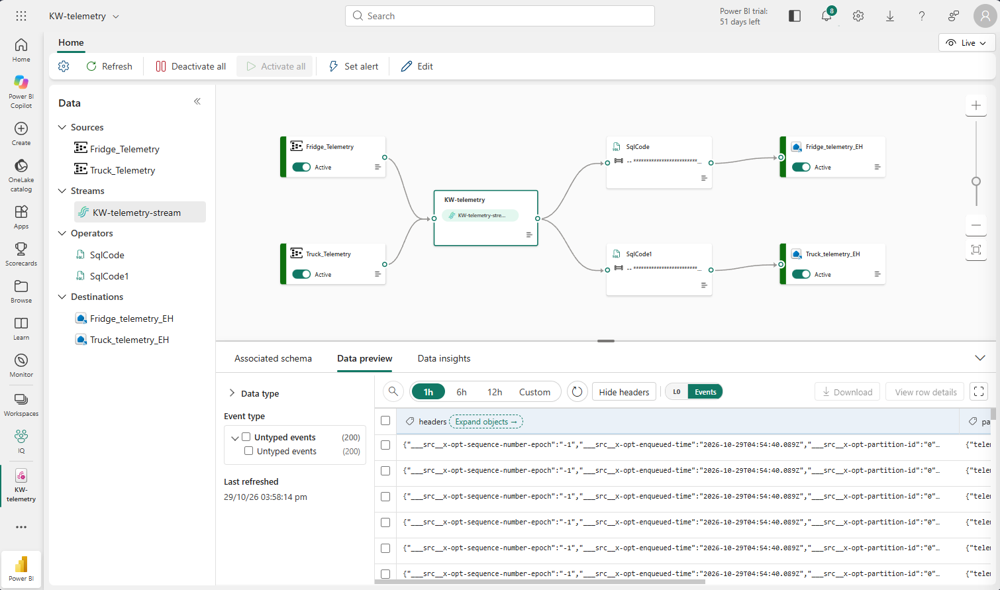
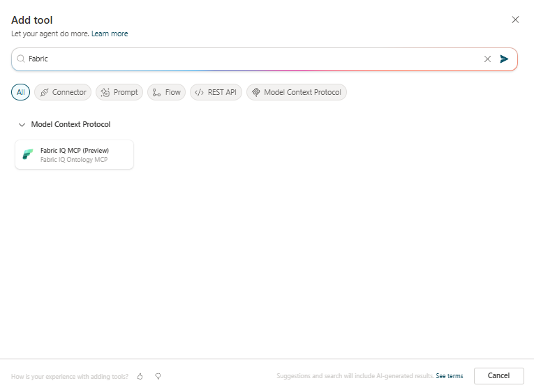
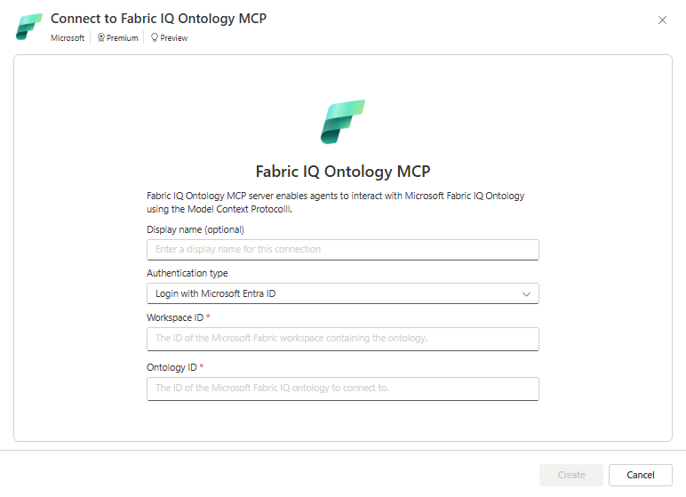
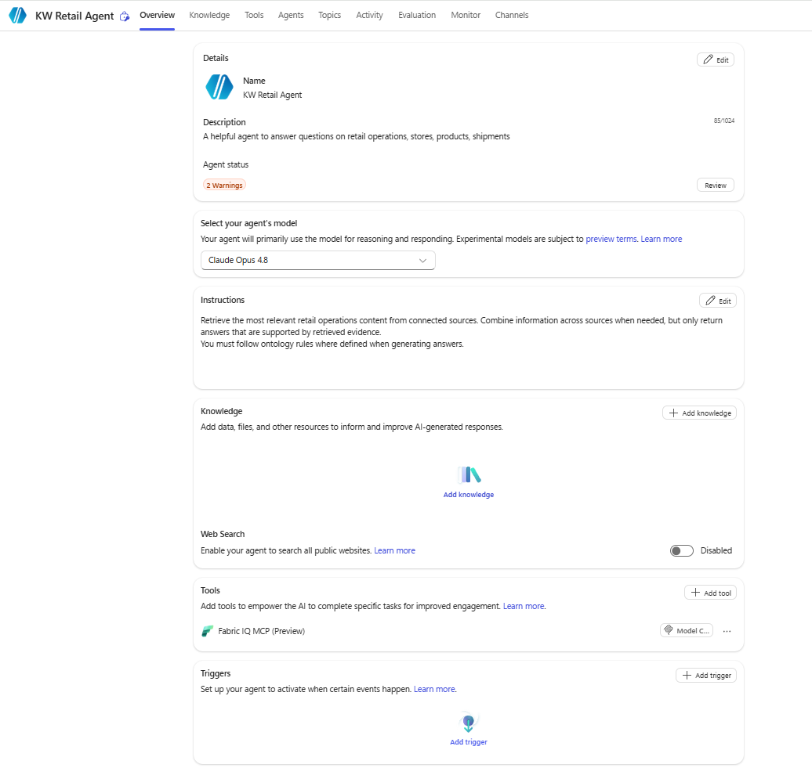
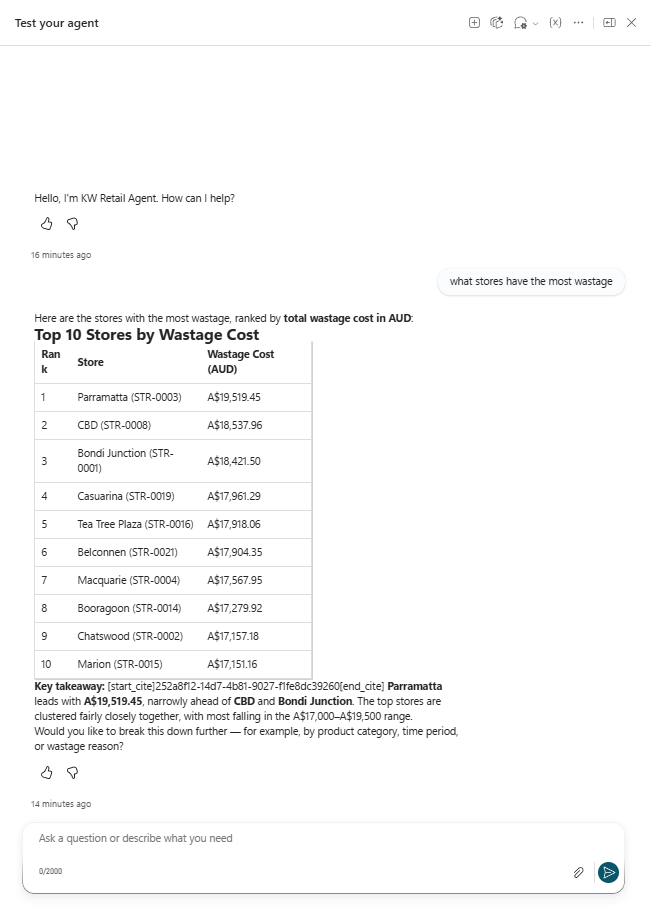
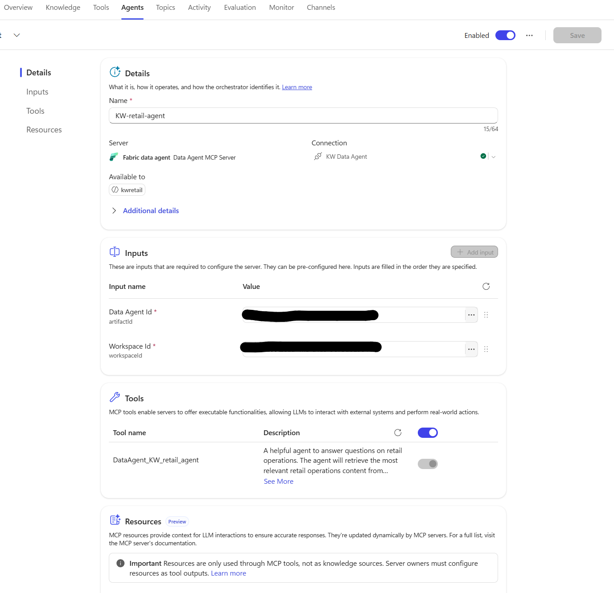

# Fabric IQ Accelerator Workshop Instructions



Build, explore and learn with the KW supermarket scenario.

Workshop guide source date: 20 October 2026.

A practical path from connected Fabric data to a governed ontology and conversational agents.
KW is fictional. The supplied pack uses synthetic sample data.

Follow sections 1-5 in order to build the core workshop, including live telemetry.
Section 6 is the only optional section: connect external agents to Fabric IQ using
Copilot Studio or Microsoft Foundry IQ. Sections 7-9 cover demonstrations,
troubleshooting, and extending the sample.

## The KW scenario: connected retail, contextual AI

KW is a fictional Australian supermarket chain spanning 22 stores across eight capital
cities and eight state distribution centres. Its teams need to connect what is sold,
what is wasted, how stock moves, and whether cold-chain equipment is operating safely.
This environment uses synthetic data to explore those questions without using real
customer records.

### The business story

A store manager sees rising spoilage. Distribution wants to know whether replenishment
or delivery delays contributed. Marketing wants to understand campaign performance,
while operations needs visibility into fridges, freezers and trucks. The useful answer
crosses departmental boundaries rather than stopping at a single table or dashboard.

### What the workshop explores

* A connected data foundation: historical sales, inventory, waste, customers, workforce,
  campaigns and logistics in `KWlakehouse`.
* Operational awareness: live fridge and truck telemetry in `KWeventhouse`, with
  Eventstream ingestion and separate real-time dashboards or Activator scenarios.
* Business context for AI: an ontology that connects entities such as Store, Sale,
  Product and Fridge to source data, relationships, terminology and descriptive rules.
* Conversational analytics: compare a Lakehouse-only Fabric data agent with an
  ontology-grounded Fabric data agent, with external-agent connections in section 6.
* Responsible interpretation: inspect the source, period, calculation, joins and
  limitations behind an answer; distinguish correlation from causation and context
  from security enforcement.

### The central exercise

Ask the same business question of two agents over the same historical data. The first
reads Lakehouse tables directly; the second uses the ontology's shared business context.
Compare how each interprets terminology, selects relationships, explains calculations
and handles ambiguity. The goal is not to show that a table-grounded agent cannot
answer, but to explore how Fabric IQ makes domain meaning explicit, reusable and
inspectable rather than leaving every consumer to infer it.

Begin with the shared historical-data comparison. Then explore the live telemetry
built in section 2 as an additional-source scenario, not as evidence that one agent
is better: the Lakehouse-only baseline cannot answer questions about sources it
cannot access.

## At a glance

This accelerator turns the KW sample pack into a hands-on Fabric IQ workshop.
Participants work with historical retail and operations data, live IoT telemetry,
a business ontology, and two Fabric data agents for comparison. Section 6 adds
external agents through Copilot Studio or Microsoft Foundry IQ.

### The experience chain

```text
CSV files and IoT events
  -> Lakehouse and Eventhouse
  -> semantic model and ontology
  -> Fabric data agent grounded on the ontology

Optional external-agent connections (section 6):
  ontology -> Copilot Studio agent via Fabric IQ Ontology MCP
  Fabric data agent -> Copilot Studio external agent
  ontology -> Foundry IQ knowledge base -> Foundry agent
```

The ontology is the shared business context: it gives names, properties, relationships,
rules, and source bindings to concepts such as Store, Customer, Sale, Fridge, and
Shipment. The ontology does not copy or secure the source data. The underlying Fabric
items remain the data and access-control boundary.

### What participants will build

* A repeatable KW workshop workspace with a Lakehouse and Eventhouse streaming
* An ontology drafted and reviewed with the Fabric Ontology Agent, then bound to the prepared data
* Two Fabric data agents: KW Tables Analyst (`KWlakehouse` tables only) and KW Fabric IQ Analyst (ontology-grounded)
* In optional section 6, a Copilot Studio or Foundry agent grounded in Fabric IQ

### Contents

* [The KW scenario: connected retail, contextual AI](#the-kw-scenario-connected-retail-contextual-ai)
* [At a glance](#at-a-glance)
* [Prerequisites](#prerequisites)
  * [Core workshop prerequisites](#core-workshop-prerequisites)
  * [External-agent prerequisites for optional section 6](#external-agent-prerequisites-for-optional-section-6)
* [1. Asset map and preparation](#1-asset-map-and-preparation)
  * [Pack inventory](#pack-inventory)
  * [Data model at a glance](#data-model-at-a-glance)
  * [Preflight checklist](#preflight-checklist)
  * [Local Python setup and requirements](#local-python-setup-and-requirements)
  * [Resource planning](#resource-planning)
* [2. Build the Fabric data foundation](#2-build-the-fabric-data-foundation)
  * [2.1 Create the workspace and items](#21-create-the-workspace-and-items)
  * [2.2 Load the historical data](#22-load-the-historical-data)
  * [2.3 Build the semantic model](#23-build-the-semantic-model)
  * [2.4 Set up telemetry](#24-set-up-telemetry)
    * [Create the Eventhouse tables](#create-the-eventhouse-tables)
    * [Create a workspace identity](#create-a-workspace-identity)
    * [Set up Event Hubs](#set-up-event-hubs)
    * [Configure the local producers](#configure-the-local-producers)
    * [Set up Eventstream](#set-up-eventstream)
    * [Start and verify the producers](#start-and-verify-the-producers)
    * [Foundation completion checklist](#foundation-completion-checklist)
* [3. Create the ontology with the Fabric Ontology Agent](#3-create-the-ontology-with-the-fabric-ontology-agent)
  * [3.1 Start the guided build](#31-start-the-guided-build)
  * [3.2 Suggested concepts and source mapping](#32-suggested-concepts-and-source-mapping)
  * [Suggested Prompt starter for the Ontology Agent](#suggested-prompt-starter-for-the-ontology-agent)
* [4. Add property metadata and business rules](#4-add-property-metadata-and-business-rules)
  * [4.1 Property metadata from custom_attributes.json](#41-property-metadata-from-custom_attributesjson)
  * [4.2 Add the draft business rules](#42-add-the-draft-business-rules)
* [5. Build a Fabric data agent using the ontology](#5-build-a-fabric-data-agent-using-the-ontology)
  * [5.1 Create and configure](#51-create-and-configure)
  * [5.2 Create the Lakehouse-only comparison agent](#52-create-the-lakehouse-only-comparison-agent)
  * [KW Tables Analyst agent instructions](#kw-tables-analyst-agent-instructions)
  * [What changes between the agents](#what-changes-between-the-agents)
  * [Keep the comparison honest](#keep-the-comparison-honest)
* [6. Connect external agents to Fabric IQ](#6-connect-external-agents-to-fabric-iq)
  * [6.1 Connect Copilot Studio Agent](#61-connect-copilot-studio-agent)
    * [Method 1: Connect using Fabric IQ Ontology MCP](#method-1-connect-using-fabric-iq-ontology-mcp)
    * [Method 2: Connect to the Fabric data agent](#method-2-connect-to-the-fabric-data-agent)
  * [6.2 Connect Microsoft Foundry IQ](#62-connect-microsoft-foundry-iq)
    * [Prepare the Foundry project and permissions](#prepare-the-foundry-project-and-permissions)
    * [Create the ontology knowledge source and knowledge base](#create-the-ontology-knowledge-source-and-knowledge-base)
    * [Create the Foundry agent and test grounding](#create-the-foundry-agent-and-test-grounding)
* [7. Workshop exercises and sample questions](#7-workshop-exercises-and-sample-questions)
  * [Suggested 15-minute walkthrough](#suggested-15-minute-walkthrough)
  * [Compare the two agents](#compare-the-two-agents)
  * [Seven demonstration stories](#seven-demonstration-stories)
    * [Story 1: Save the ice cream](#story-1-save-the-ice-cream)
    * [Story 2: Where is my truck](#story-2-where-is-my-truck)
    * [Story 3: Find the bleed](#story-3-find-the-bleed)
    * [Story 4: FY26 closeout](#story-4-fy26-closeout)
    * [Story 5: Plan the campaign](#story-5-plan-the-campaign)
    * [Story 6: Workforce readiness](#story-6-workforce-readiness)
    * [Story 7: Sustainability tile](#story-7-sustainability-tile)
  * [Controlled comparison: questions and evidence](#controlled-comparison-questions-and-evidence)
  * [Capture what actually happened](#capture-what-actually-happened)
  * [Workshop wrap-up](#workshop-wrap-up)
  * [Sample questions for the Ontology Agent](#sample-questions-for-the-ontology-agent)
  * [Sample questions for the Fabric data agent and Copilot Studio agent](#sample-questions-for-the-fabric-data-agent-and-copilot-studio-agent)
* [8. Troubleshooting and next steps](#8-troubleshooting-and-next-steps)
  * [Local environment and data foundation](#local-environment-and-data-foundation)
    * [Resolve missing Event Hubs Send permission](#resolve-missing-event-hubs-send-permission)
  * [Ontology and agents](#ontology-and-agents)
  * [Next-steps checklist](#next-steps-checklist)
* [9. Regenerate or extend the sample data](#9-regenerate-or-extend-the-sample-data)
  * [Simulation details for rehearsal](#simulation-details-for-rehearsal)
* [References and source provenance](#references-and-source-provenance)

## Prerequisites

Confirm these prerequisites before starting the build. Live telemetry, including
Azure Event Hubs and local producers, is part of the core workshop. External-agent
prerequisites apply only if you complete section 6.

### Core workshop prerequisites

* A Microsoft Entra account with access to Microsoft Fabric and a workspace
  assigned to a Fabric capacity of F2 or higher
* Workspace permissions to create and configure the Lakehouse, notebooks,
  semantic model, ontology, and Fabric data agents, plus read access to the
  connected data sources
* Tenant and [region availability](https://learn.microsoft.com/en-us/fabric/admin/region-availability#fabric-workload-and-feature-availability)
  for the Fabric ontology item, Fabric Ontology
  Agent, and Fabric data agents, with the relevant tenant settings enabled
* A local copy of the [latest release ZIP](https://github.com/cro27/fabric-iq-ontology-workshop/releases/download/v0.1.1/fabric-iq-ontology-workshop-v0.1.1.zip), including the historical CSV files,
  notebooks, ontology metadata, and agent instructions
* A browser with access to Fabric; the historical-data notebooks run in Fabric
  and do not require a local Python environment
* An Azure subscription with permission to provision a Standard-tier Event Hubs
  namespace and two event hubs, plus an administrator able to assign the required
  data-plane roles
* A Fabric workspace identity with `Azure Event Hubs Data Receiver` access and a
  separate producer identity with `Azure Event Hubs Data Sender` access
* Permission to create and configure an Eventstream, Eventhouse, and KQL database
  in the workshop workspace
* PowerShell, uv, and Python 3.11 for the local telemetry producers, with
  dependencies installed through
  [local Python setup](#local-python-setup-and-requirements)

> [!IMPORTANT]
> Confirm current capacity, licensing, preview availability, and tenant settings
> with your administrator before the workshop. A Fabric capacity of F2 or higher
> is required, but capacity alone does not guarantee that every ontology, data
> agent, or Copilot Studio feature is available. See
> [resource planning](#resource-planning).

### External-agent prerequisites for optional section 6

* For Copilot Studio, access and licensing, permission to create and test an agent,
  and availability of the selected Fabric connection in your environment
* For Foundry IQ, an Azure subscription with permission to create Foundry
  resources, a Foundry project with a model deployment, and access to the
  project's Azure AI Search resource
* The Foundry project's managed identity assigned `Reader` on the Fabric capacity
  resource, plus `Cognitive Services User` and `Search Index Data Contributor`
  on the Azure AI Search resource
* For Foundry IQ, Edge or Chrome signed in with the same identity that can access
  both the Foundry project and the Fabric workspace

Use the supplied synthetic data. Apply your organization's privacy, access,
retention, and governance controls before substituting real data or publishing
agent responses outside Fabric.

## 1. Asset map and preparation

Use the repository root as the source-pack location. All asset links below are
relative so they continue to work after the repository is uploaded to GitHub.

| Asset                                                       | What it contributes                                                                                                                                                                                                 |
| ----------------------------------------------------------- | ------------------------------------------------------------------------------------------------------------------------------------------------------------------------------------------------------------------- |
| [README.md](./README.md)                                    | Canonical build order for the Fabric workspace, Lakehouse, Eventhouse, Eventstream, ingestion notebooks, semantic model, and seven demo stories.                                                                    |
| [KW Prompt.txt](./KW%20Prompt.txt)                          | The prompt used to create the dataset, notebooks, scripts, and other assets.                                                                                                                                        |
| [data/](./data/)                                            | Interlinked historical CSVs for stores, warehouses, products, inventory, suppliers, sales, customers, workforce, campaigns, energy, and wastage (about 110 MB per README).                                          |
| [notebooks/](./notebooks/)                                  | `01_create_schema.ipynb` creates the Lakehouse schema; `02_ingest_csvs.ipynb` loads the CSVs; `03_build_semantic_model.ipynb` builds the Direct Lake semantic model. A no-partition schema variant is also present. |
| [telemetry/](./telemetry/) and [scripts/](./scripts/)       | Sample telemetry plus a deterministic generator and Event Hubs producers for fridge/freezer and truck events.                                                                                                       |
| [custom_attributes.json](./ontology/custom_attributes.json) | Design reference for Customer and Fridge properties, synonyms, PII labels, units, and Lakehouse/Eventhouse bindings.                                                                                                |
| [rules.json](./ontology/rules.json)                         | Nineteen draft natural-language business rules with linked entities/properties, relationship references, and annotations where supplied.                                                                             |
| [KWagent/](./KWagent/)                                      | Optional Python CLI sample using the ontology MCP endpoint and Microsoft Agent Framework. It is separate from the in-product Fabric data agent and has its own Foundry/configuration prerequisites.                 |

### Pack inventory

The current [data folder](./data/) contains 27 interlinked CSVs, approximately
110 MB in the README's estimate. The README's tree labels the pack as 25 CSVs;
use the files actually supplied in your copy.

```text
data\
  stores.csv, warehouses.csv, fridges_freezers.csv
  products.csv, suppliers.csv, store_stock.csv, promotions.csv
  inwards_goods.csv, shipments.csv, shipment_lines.csv
  forklifts.csv, pick_events.csv
  trucks.csv, drivers.csv, routes.csv, trips.csv
  sales.csv, sale_lines.csv, customers.csv
  employees.csv, employee_skills.csv, performance_kpis.csv, training_records.csv
  campaigns.csv, campaign_performance.csv
  energy_consumption.csv, wastage.csv
notebooks\
  01_create_schema.ipynb
  01_create_schema_nopart.ipynb
  02_ingest_csvs.ipynb
  03_build_semantic_model.ipynb
scripts\
  generate_data.py
  fridge_telemetry_producer.py
  truck_telemetry_producer.py
  requirements.txt
  .env.example
ontology\
  custom_attributes.json
  rules.json
KWagent\
```

The README also describes a Tabular Editor/TMDL alternative. Those assets are
not present in this copy; the notebook is the runnable semantic-model path.

### Data model at a glance

The sample covers Stores, Sales, Distribution, Fleet Management, Marketing,
HR, and IT. The silver-layer star schema brings together sales and sale lines,
shipments, picking, products, suppliers, stores, and warehouses. Date dimensions
support time-based analysis. Fridge/freezer and truck identifiers connect static
assets to live Eventhouse readings.

```text
Date -> Sales -> Sale Lines -> Product -> Supplier
          |                     |
        Store <------------ Shipments -> Warehouse -> Pick Events
          |
     Fridge / Freezer -> fridge_telemetry

Warehouse -> Truck / Trip -> Store
                |
         truck_telemetry
```

This is a conceptual orientation, not a substitute for verified join keys.
Use notebook output and semantic-model relationships when authoring bindings.
Default live intervals are five minutes per fridge/freezer and 30 minutes per truck.

### Preflight checklist

* Confirm workspace and Fabric capacity access, tenant permission to create
  ontology/Fabric items, and read access to the Lakehouse/Eventhouse sources.
* Confirm the source notebooks and files are present; run the Lakehouse notebooks
  in [section 2](#2-build-the-fabric-data-foundation) in order.
* Confirm Event Hubs, Eventstream, KQL database, and credentials are ready for the
  core live-telemetry build.
* Use the supplied synthetic data only. If partners substitute real data, apply their
  privacy, access, retention, and Purview controls before connecting agents.

> [!NOTE]
> As of 20 October 2026, the source guide describes the Fabric ontology item and
> Ontology Agent as preview. Verify tenant availability, region, feature settings,
> and current UI before a workshop.

### Local Python setup and requirements

Install [uv](https://docs.astral.sh/uv/getting-started/installation/).
Both telemetry producers require Python 3.10 or later; use Python 3.11 for this
workshop. Local Python is for generators and telemetry producers. The Fabric
notebooks run in Fabric, not in this local virtual environment.

Run these commands in **PowerShell from the project root**:

```powershell
uv venv .\scripts\.venv --python 3.11
uv pip install --python .\scripts\.venv\Scripts\python.exe -r .\scripts\requirements.txt
.\scripts\.venv\Scripts\python.exe -c "from azure.eventhub import EventHubProducerClient; from azure.identity import DefaultAzureCredential; from dotenv import load_dotenv; print('Telemetry dependencies available')"
```

The shared [requirements file](./scripts/requirements.txt) installs:

| Package          | Minimum version | Purpose                                                    |
| ---------------- | --------------- | ---------------------------------------------------------- |
| `azure-eventhub` | 5.11.0          | Send telemetry to Event Hubs                               |
| `azure-identity` | 1.15.0          | Authenticate both producers using `DefaultAzureCredential` |
| `python-dotenv`  | 1.0.0           | Load the shared local environment configuration            |

Select `scripts\.venv\Scripts\python.exe` using **Python: Select Interpreter**
in VS Code. You can optionally activate the environment:

```powershell
.\scripts\.venv\Scripts\Activate.ps1
```

The commands in this guide invoke the environment's interpreter directly, so
activation is not required and a PowerShell activation-policy restriction does
not block the walkthrough. If you see `ModuleNotFoundError: No module named
'azure'`, install the requirements into the interpreter running the producer.
Do not install the legacy `azure` package.

### Resource planning

The README proposes the following workshop resources. Confirm current licensing,
capacity, feature, and tenant requirements before provisioning; this is a sample
configuration, not a guarantee of feature availability on every SKU.

| Resource                                      | Workshop configuration                                     |
| --------------------------------------------- | ---------------------------------------------------------- |
| Microsoft Fabric capacity                     | Capacity assigned to the `KW Demo` workspace               |
| Event Hubs namespace                          | Standard tier                                              |
| Event Hub `kw-fridge-telemetry`               | Four partitions                                            |
| Event Hub `kw-truck-telemetry`                | Two partitions                                             |
| Fabric Lakehouse                              | `KWlakehouse`                                              |
| Fabric Eventhouse and KQL database            | `KWeventhouse` containing `KW_rt`                          |

Use a Fabric capacity of F2 or higher for this workshop. Verify the requirements
of ontology, data agents, and Copilot Studio separately in your tenant before
committing to a capacity choice.

## 2. Build the Fabric data foundation

Complete this data foundation before asking the Ontology Agent to discover
sources. The steps consolidate the README run book and the workshop guide.

### 2.1 Create the workspace and items

1. Create a Fabric workspace named `KW Demo`.
2. Create a Lakehouse named `KWlakehouse`.
3. Create an Eventhouse named `KWeventhouse` and a KQL
   database named `KW_rt`.
4. Open the Lakehouse SQL analytics endpoint and record its server name if your
   semantic-model authoring path requires it.

### 2.2 Load the historical data

1. Open `KWlakehouse`. In the **Files** browser, create `KW/raw` and upload
   every CSV from [data/](./data/) to `Files/KW/raw/`. Use drag-and-drop or
   OneLake File Explorer for bulk upload.
2. Import the notebooks from [notebooks/](./notebooks/) into the workspace.
3. Before execution, review their configuration cells. The supplied schema and
   ingestion notebooks use the legacy value `LAKEHOUSE = "KW_lh"`; change this
   to `KWlakehouse` in your imported copies. The ingestion notebook's
   `RAW_PATH` must remain `Files/KW/raw`, matching the upload location.
4. Open [01_create_schema.ipynb](./notebooks/01_create_schema.ipynb), attach
   `KWlakehouse`, and run all cells. The
   [no-partition variant](./notebooks/01_create_schema_nopart.ipynb) is an
   alternative schema path, not an additional notebook to run over the same tables.
5. Open [02_ingest_csvs.ipynb](./notebooks/02_ingest_csvs.ipynb), attach
   `KWlakehouse`, and run all cells. Confirm table creation, row counts, and
   the optimization pass complete.

Expect approximately 97,000 sales, 634,000 sale lines,
191,000 pick events, 118,000 shipment lines, and 6,000 trips. Counts are approximate
because the data is generated. Inspect the notebook output rather than treating
these figures as exact acceptance thresholds.

> [!IMPORTANT]
> Use `Files/KW/raw/`, not the original workshop's `Files/raw/`.
> Attaching a Lakehouse does not correct a hard-coded legacy `LAKEHOUSE` value.

### 2.3 Build the semantic model

#### Option A: Fabric notebook, recommended

1. Open [03_build_semantic_model.ipynb](./notebooks/03_build_semantic_model.ipynb)
   in Fabric and attach it to `KWlakehouse`.
2. Review configuration cells before running. The supplied notebook uses
   `LAKEHOUSE = "KW_LH"` and `DATASET = "KWretail"`; set `LAKEHOUSE` to
   `KWlakehouse` and choose the intended model name. `WORKSPACE = None`
   selects the current workspace.
3. Review overwrite settings before rerunning against an existing model.
4. Run all cells, including the notebook's `semantic-link-labs` installation
   cells, and inspect results.

The notebook uses [semantic-link-labs](https://github.com/microsoft/semantic-link-labs)
to build a Direct Lake semantic model, rename tables and columns to business-friendly
names, apply data categories and AUD format strings, configure 21 relationships,
publish 28 DAX measures into `_Measures`, and create three perspectives:
Operations, Commercial, and Sustainability. Re-run individual cells only after
checking their prerequisites and overwrite behaviour.

Measures include sales, gross margin percentage, year-on-year change,
Australian financial-year YTD ending 30 June, pick error rate, on-time percentage,
ROAS, energy per square metre, and wastage as a percentage of sales.
Confirm the resulting model and measures before building reports.

#### Option B: TMDL through Tabular Editor, conditional alternative

The README describes a [Tabular Editor 2](https://tabulareditor.com) path using
`semantic_model\build_semantic_model.py` and `semantic_model\KW_model.tmdl`.
These assets are not present in this copy. Use this alternative only if your
distribution includes them and you have installed Tabular Editor.

With those additional files available, the README's command translated to
PowerShell and the local interpreter is:

```powershell
.\scripts\.venv\Scripts\python.exe .\semantic_model\build_semantic_model.py `
    --workspace "KW Demo" `
    --dataset "KW" `
    --tmdl .\semantic_model\KW_model.tmdl `
    --tabular-editor "C:\Program Files (x86)\Tabular Editor\TabularEditor.exe"
```

Keep the chosen semantic-model name consistent across your workshop.

#### Option C: Fabric UI, conditional alternative

Open `KWlakehouse`, select **New semantic model**, and add the `dim_*` and
`fact_*` tables. Configure relationships, data categories, formatting, and
measures in the model editor. The README suggests copying DAX from
`KW_model.tmdl`; that file is not supplied here. Use Option A if you need the
provided measures without authoring them manually.

### 2.4 Set up telemetry

Live telemetry is part of the core workshop. Complete the Eventhouse, Event Hubs
permissions, configuration, and Eventstream setup before starting the producers.

#### Create the Eventhouse tables

In the KQL database `KW_rt`, run each management command separately:

```kql
.create table fridge_telemetry (
    telemetry_type: string, event_time: datetime, store_id: string, fridge_id: string,
    unit_type: string, code_name: string, model: string,
    temperature_c: real, humidity_pct: real, door_open: bool,
    min_safe_temp_c: real, max_safe_temp_c: real
)
```

```kql
.create table truck_telemetry (
    telemetry_type: string, event_time: datetime, truck_id: string, rego: string, trip_id: string,
    origin_warehouse_id: string, destination_store_id: string,
    latitude: real, longitude: real, speed_kmh: real, heading_deg: real,
    cargo_temp_c: real, progress_pct: real, status: string
)
```

Apply the sample 30-day retention policies:

```kql
.alter-merge table fridge_telemetry policy retention softdelete = 30d
```

```kql
.alter-merge table truck_telemetry policy retention softdelete = 30d
```

For existing tables, inspect the schema first rather than attempting to
recreate them. Add the event discriminator if missing:

```kql
.alter-merge table fridge_telemetry (telemetry_type: string)
```

```kql
.alter-merge table truck_telemetry (telemetry_type: string)
```

Historical events do not acquire this field retroactively. Restart current
producers before relying on discriminator filters for new events.

#### Create a workspace identity

In Fabric, create a workspace identity following the
[workspace identity instructions](https://learn.microsoft.com/en-us/fabric/security/workspace-identity).

#### Set up Event Hubs

In Azure Portal:

1. Create a Standard-tier Event Hubs namespace.
2. Create `kw-fridge-telemetry` with four partitions.
3. Create `kw-truck-telemetry` with two partitions.
4. Add the workspace identity to the `Azure Event Hubs Data Receiver` role at the
   namespace's **Access control (IAM)**. This is needed for Fabric to read the Event Hubs.
5. Assign `Azure Event Hubs Data Sender` to the identity that will run the
   producers. Prefer each hub's **Access control (IAM)** for least privilege;
   namespace scope allows sending to all hubs in the namespace.

The receiver identity used by Fabric and the sender identity used by the local
producers are separate permission checks. Generic management roles such as
Contributor do not replace these data-plane roles.

See [Create an event hub using Azure portal](https://learn.microsoft.com/en-us/azure/event-hubs/event-hubs-create).

#### Configure the local producers

Complete [local Python setup](#local-python-setup-and-requirements) first.
Install the [Azure CLI](https://learn.microsoft.com/cli/azure/install-azure-cli)
for local Entra authentication.

1. From the project root, copy the [environment template](./scripts/.env.example)
   only if you do not already have a local file:

   ```powershell
   if (-not (Test-Path .\scripts\.env)) {
       Copy-Item .\scripts\.env.example .\scripts\.env
   }
   ```

2. Set the following values in your local `scripts\.env`:

   ```dotenv
   EVENT_HUB_FULLY_QUALIFIED_NAMESPACE="<namespace>.servicebus.windows.net"
   EH_NAME_FRIDGE="kw-fridge-telemetry"
   EH_NAME_TRUCK="kw-truck-telemetry"
   ```

   Use the namespace hostname only, without `https://`, a hub path, or a connection
   string. Both producers load the file beside their script regardless of working
   directory; existing terminal environment variables take precedence.

3. Sign in to the tenant containing the namespace and confirm the account:

   ```powershell
   az login --tenant <tenant-id>
   az account show
   ```

4. Confirm the authenticated identity has effective Data Sender access, allowing
   time for role assignments to propagate. `DefaultAzureCredential` may select
   another configured credential before Azure CLI; verify the identity actually
   used. A managed identity with Data Sender access can be used when running in Azure.
5. Keep [fridges_freezers.csv](./data/fridges_freezers.csv) in [data/](./data/)
   for the fridge producer. The truck producer requires
   [trucks.csv](./data/trucks.csv), [warehouses.csv](./data/warehouses.csv),
   [stores.csv](./data/stores.csv), and [routes.csv](./data/routes.csv).
   Preserve headers and matching warehouse/store identifiers.
6. Allow DNS resolution, outbound AMQP/TLS on TCP 5671 to the namespace, and
   HTTPS on TCP 443 for authentication. Namespace firewall/private endpoint
   settings must allow access from the producer machine.

Both current producers use `DefaultAzureCredential`, not `EH_CONNECTION_STRING`.
An old connection-string entry is ignored and can be removed from your local
configuration. Namespaces with SAS authentication disabled are supported; do not enable SAS to resolve an Entra permissions problem.

> [!WARNING]
> Keep secrets in a local ignored `.env` file or an approved secret store.
> Never place actual credentials in documentation, source control, or an agent prompt.
> Confirm your ignore rules exclude the file before uploading to GitHub.

#### Set up Eventstream

In Fabric:

1. In your workspace, create an Eventstream named `KW_es`.
2. Add the fridge telemetry source from your Fridge Event Hub. Use **Workspace
   Identity** for the authentication kind.

   See [Add an Azure Event Hubs source to an eventstream](https://learn.microsoft.com/en-us/fabric/real-time-intelligence/event-streams/add-source-azure-event-hubs).

3. Do the same for truck telemetry, choosing the Truck Event Hub.
4. Add **Transform event > SQL Code** to filter the events by fridge telemetry.

   See [Process events using the SQL code editor](https://learn.microsoft.com/en-us/fabric/real-time-intelligence/event-streams/process-events-using-sql-code-editor).

   Use the following SQL, changing `INTO` and `FROM` to match your source and
   destination names:

   ```sql
   SELECT telemetry_type, event_time, store_id, fridge_id, unit_type,
          code_name, model, temperature_c, humidity_pct, door_open,
          min_safe_temp_c, max_safe_temp_c
   INTO [Fridge_telemetry_EH]
   FROM [KW-telemetry-stream]
   WHERE telemetry_type = 'fridge'
   ```

5. Do the same for truck telemetry using the following SQL:

   ```sql
   SELECT telemetry_type, event_time, truck_id, rego, trip_id,
          origin_warehouse_id, destination_store_id,
          latitude, longitude, speed_kmh, heading_deg, cargo_temp_c,
          progress_pct, status
   INTO [Truck_telemetry_EH]
   FROM [KW-telemetry-stream]
   WHERE telemetry_type = 'truck'
   ```

6. Add a KQL Database destination for each transform event, with JSON input format.
   Map every projected field to the corresponding table column:
   * Fridge telemetry goes to `KW_rt.fridge_telemetry`.
   * Truck telemetry goes to `KW_rt.truck_telemetry`.
7. Publish the Eventstream to start the data load.

The projections preserve the current producer payloads, including safe-temperature
limits needed for excursion queries. 

When you have finished your Eventstream canvas will look like this, using a combined intake stream, filtering on telemetry_type:



#### Start and verify the producers

From the project root, run the producers in separate PowerShell terminals:

```powershell
# Terminal 1
.\scripts\.venv\Scripts\python.exe .\scripts\fridge_telemetry_producer.py
```

```powershell
# Terminal 2
.\scripts\.venv\Scripts\python.exe .\scripts\truck_telemetry_producer.py
```

Check each terminal for successful send messages, then verify Eventstream
ingestion and query recent data in `KW_rt`:

```kql
fridge_telemetry
| where event_time > ago(15m)                                                    |
| summarize readings = count(), latest_event = max(event_time) by telemetry_type |
```

```kql
truck_telemetry
| where event_time > ago(1h)                                                     |
| summarize readings = count(), latest_event = max(event_time) by telemetry_type |
```

The fridge script fixes `INTERVAL=300` and `SPEEDUP=1` in its code; it does not
read `EH_INTERVAL_SECONDS` or `EH_SPEEDUP`. The truck script reads both:
`EH_INTERVAL_SECONDS` defaults to 1800 and `EH_SPEEDUP` defaults to 1.
For example, `EH_SPEEDUP=60` reduces its default send interval to 30 seconds.
Restart the affected producer after configuration changes. Press **Ctrl+C**
in each terminal when the demonstration is complete.

#### Foundation completion checklist

* Historical tables are populated and sample counts have been reviewed.
* The semantic model exposes the intended relationships, measures, and perspectives.
* For live demonstrations, both telemetry tables receive current events with the
  correct discriminator, field types, and mappings.
* Sender and receiver permissions have been tested independently.
* Notebook configuration and actual catalog item names agree before ontology discovery.

## 3. Create the ontology with the Fabric Ontology Agent

Use the Ontology Agent inside a new Fabric ontology item to discover the workspace
data, draft entity types and bindings, validate the draft, and publish it. The agent
works in Plan mode by default and previews changes; switch to Act mode only after
reviewing the proposal.

### 3.1 Start the guided build

1. In the `KW Demo` workspace, create a new **Ontology** item and open it.
2. On the **Get started** canvas, select **Start with Ontology agent**.
3. In the chat, ask the agent to discover data sources in the workspace. The workshop
   describes discovery of the semantic model, which links to `KWlakehouse`, but does
   not contain the `KW_rt` Eventhouse data. Prompt the agent to look for and include
   the Eventhouse.
4. Stay in Plan mode while the agent scopes the domain, samples tables, drafts
   entity types, relationships, bindings, and contextualizations, and runs validation.
5. Open the draft preview. Check entity names, primary keys, source table/column
   mappings, relationships, time-series settings, and warnings against the actual notebook output.
6. Ask for corrections in chat. Once the proposal is sound, switch to Act mode and
   approve the apply/publish action. Confirm the ontology canvas shows the entities
   and relationship graph.
7. Use the agent's **Test the ontology** suggestions.

### 3.2 Suggested concepts and source mapping

| Business concept   | KW data grounding to validate                                                                                                         |
| ------------------ | ------------------------------------------------------------------------------------------------------------------------------------- |
| Store              | `dim_store`; use store key, city/state, and location properties.                                                                      |
| Cold Chain Asset   | `dim_fridge` plus refrigerated trucks where relevant; distinguish a static asset from its time-series readings.                       |
| Sale               | `fact_sales` and `fact_sale_lines`; verify keys and the sales-to-line/product/customer relationships.                                 |
| Replenishment      | `fact_shipments` and `fact_inwards_goods`; connect shipment, warehouse, store, and product concepts where the source keys support it. |
| Pick Performance   | `fact_pick_events`; relate pick events to the warehouse, employee/forklift, and relevant operational measures.                        |
| Live Asset Reading | `KW_rt.fridge_telemetry` and `truck_telemetry`; use `event_time` as the time-series ordering/timestamp column.                        |
| Customer Cohort    | `dim_customer`; support aggregation by `loyalty_tier` and `state` without exposing direct identifiers or personal details.            |

### Suggested Prompt starter for the Ontology Agent

```text
Build a KW supermarket ontology from the sources in this workspace. First discover
the actual Lakehouse and Eventhouse tables and their schemas; do not invent or
assume table names, keys, or joins.

Model Store, Cold Chain Asset, Sale, Replenishment, Pick Performance, Live Asset
Reading, Customer, Product, Warehouse, Employee, Campaign, and the other concepts
supported by the data. Bind properties to the correct source columns; model fridge
and truck telemetry as time series ordered by event_time.

Use the attached KW Prompt as business context and the custom_attributes.json and
rules.json files as review inputs. Identify mismatches and unresolved joins instead
of silently guessing. Treat customer and employee personal data as sensitive;
prefer aggregate answers and do not expose direct PII.

Stay in Plan mode, show evidence and validation warnings, and wait for my review
before applying changes.
```

## 4. Add property metadata and business rules

The [JSON files](./ontology/) are design inputs for the ontology build. Use the files to prompt and review the Ontology
Agent proposal, then apply the metadata and rules through the ontology authoring
surfaces supported in your tenant.

### 4.1 Property metadata from custom_attributes.json

Use [custom_attributes.json](./ontology/custom_attributes.json) as the design reference.

| Entity   | Source metadata to carry into the ontology                                                                                                                                                                                                                                               |
| -------- | ---------------------------------------------------------------------------------------------------------------------------------------------------------------------------------------------------------------------------------------------------------------------------------------- |
| Customer | Key: `customer_id`. Properties include `name`, `email`, `date_of_birth`, `gender`, `postcode`, `state`, `joined_date`, `loyalty_tier`, and `preferred_channel`. Synonyms are supplied for the entity and several properties. The JSON marks `name`, `email`, and `date_of_birth` as PII. |
| Fridge   | Key: `fridge_id`. Includes static asset properties plus `event_time`, `temperature_c`, `humidity_pct`, and `door_open`. The JSON supplies Celsius units and synonyms; telemetry is a time series sourced from `fridge_telemetry`.                                                        |

Apply property descriptions, types, synonyms, and available custom metadata where the
current ontology editor supports them. For `Customer`, treat `postcode` as sensitive
too: [rules.json](./ontology/rules.json) includes it in the PII rule even though
[custom_attributes.json](./ontology/custom_attributes.json) does not mark it as PII.
Agree one classification before the workshop.

> [!WARNING]
> Data protection may not be enforced by an ontology rule. The PII rule is natural-language
> business context for consumers; it does guarantee to not mask query results or replace source
> permissions, Purview policies, or access controls. Secure or mask personal fields
> in the underlying data and enforce least privilege before publishing an agent.

### 4.2 Add the draft business rules

Use the 19 rules in [rules.json](./ontology/rules.json) as the review input.

Use the Ontology Agent to create business rules. Use [rules.json](./ontology/rules.json) as the plan input. Prompt the agent for additional business rules. When you are satisfied with the plan, switch to Act and prompt the agent to implement them. 

| Rule                                               | Intent                                                                                                                                                                                            |
| -------------------------------------------------- | ------------------------------------------------------------------------------------------------------------------------------------------------------------------------------------------------- |
| Customer ID required                               | Every Customer must have a non-empty `customer_id`.                                                                                                                                               |
| Sales customer reference must exist                | Every `Sales.customer_id` must match an existing `Customer.customer_id`.                                                                                                                          |
| Sale line sale reference must exist                | Every `SaleLine.sale_id` must match an existing `Sales.sale_id`.                                                                                                                                  |
| Sale line product reference must exist             | Every `SaleLine.product_id` must match an existing `Product.product_id`.                                                                                                                          |
| Campaign start date must precede end date          | Every Campaign must have `start_date` less than or equal to `end_date`.                                                                                                                           |
| Promotion start date must precede end date         | Every Promotion must have `start_date` less than or equal to `end_date`.                                                                                                                          |
| Non-negative numeric values                        | Quantity, amount, price, cost, and usage fields must be greater than or equal to zero unless business logic explicitly allows negatives.                                                          |
| Fridge telemetry values must be valid              | Require `event_time`, humidity between 0 and 100, and `temperature_c` between `min_safe_temp_c` and `max_safe_temp_c`.                                                                            |
| PII must be masked before exposure                 | Mask or redact personal-data properties before showing them in query results, dashboards, exports, logs, or downstream reports; referenced fields cover Driver, Employee, Customer, and Supplier. |
| Store stock should not be negative                 | Every StoreStock record must have `qty_on_hand` and `reorder_point` greater than or equal to zero.                                                                                                |
| Sales total must reconcile                         | Every Sales record must have `total` equal to `subtotal + tax_total`.                                                                                                                             |
| Sale line quantity must be positive                | Every `SaleLine.qty` must be greater than zero.                                                                                                                                                   |
| Employee cannot report to self                     | Every Employee must have `manager_employee_id` different from `employee_id`.                                                                                                                      |
| Employee skill certification dates must be ordered | Every EmployeeSkill record must have `certified_date` less than or equal to `expiry_date`.                                                                                                        |
| Product supplier reference must exist              | Every `Product.supplier_id` must match an existing `Supplier.supplier_id`.                                                                                                                        |
| Inwards goods references must exist                | Every `InwardsGoods.product_id`, `supplier_id`, and `warehouse_id` must match an existing `Product.product_id`, `Supplier.supplier_id`, and `Warehouse.warehouse_id`, respectively.               |
| Store and warehouse managers must exist            | Every `Store.manager_employee_id` and `Warehouse.manager_employee_id` must match an existing `Employee.employee_id`.                                                                              |
| Operational event dates must be present            | Require `Sales.sale_date`, `InwardsGoods.receipt_date`, `PickEvent.pick_date`, and `Wastage.date`.                                                                                                |
| Performance KPI score must be between 0 and 100    | Every `PerformanceKPI.kpi_score` must be between 0 and 100, assuming the scorecard uses that normalized scale.                                                                                    |

Ontology business rules are discoverable context for agents and applications; they
are not executed by the ontology to validate rows or trigger actions. Use the data
pipeline, source constraints, or a dedicated rules/alerting service for enforcement.

## 5. Build a Fabric data agent using the ontology

A Fabric data agent can use an ontology as one of its data sources. It is the
conversational analytics layer: it selects the relevant source, generates a read
query, runs it under the user's permissions, and explains results.

### 5.1 Create and configure

1. In the `KW Demo` workspace, select **+ New item**, search for **Fabric data agent**,
   and create one named `KW Fabric IQ Analyst`.
2. In the OneLake catalog, add the published KW ontology as a data source. The source
   guide states that the data agent supports up to five sources; start with the
   ontology only so the first exercise shows its value clearly.
3. In Explorer, select the ontology including all entities.
4. Add the following agent instructions:

   ```text
   You are a helpful agent to answer questions on retail operations, like stores,
   products, shipments and more.

   Retrieve the most relevant retail operations content from connected sources.
   Combine information across sources when needed, but only return answers that
   are supported by retrieved evidence.

   Use the ontology's business names, cite which source/period supports a conclusion,
   prefer aggregate views, do not reveal PII, ask for missing date/store scope,
   and never invent missing data.

   You must follow ontology rules where defined when generating answers.

   Support group by in GQL.
   ```

5. Publish the data agent after testing. Confirm the published agent can answer only
   within the allowed data sources and the test user's permissions.

### 5.2 Create the Lakehouse-only comparison agent

1. Create a second Fabric data agent named `KW Tables Analyst` in the same workspace.
   This is an intentional baseline, not a replacement for `KW Fabric IQ Analyst`.
2. Add `KWlakehouse` as its only data source. Do not add the ontology, a semantic
   model or a KQL database. Select the historical tables needed for the comparison
   questions, including their keys and relevant dimension tables.
3. Configure `KW Fabric IQ Analyst` so the comparison uses ontology entities bound
   to the same historical tables and columns. Exclude live telemetry from the
   comparison questions; keep other sources out of the initial comparison.
4. Use the same test identity, effective source permissions, fixed date range,
   store scope, selected data coverage and refresh state. Run each question in a
   fresh chat to avoid earlier messages supplying extra context.
5. Give both agents the shared instructions below. Do not paste ontology synonyms,
   relationships or rules into the baseline instructions. Either omit custom query
   examples for both, or use equivalent examples and disclose them.
6. Test and, if required for the workshop, publish both agents. Inspect generated
   queries and source results before showing the comparison to participants.

### KW Tables Analyst agent instructions

```text
Answer only from your configured, accessible sources. State the period, source
tables or entities, calculation and important assumptions. Use aggregate results
and do not expose personal information. Ask for clarification when a business
definition or scope is missing. Do not invent relationships, thresholds or data.
Distinguish observed associations from proven causes.
```

### What changes between the agents

`KW Tables Analyst` has physical table and column schemas, plus any metadata already
exposed by the Lakehouse. `KW Fabric IQ Analyst` additionally has the selected
ontology's business entities, supported relationships, synonyms and descriptive
context. The baseline may already answer well; record that outcome. Ontology
metadata helps only if it is authored correctly, bound to the right data and
actually consumed by the agent.

### Keep the comparison honest

Do not claim a measured accuracy or productivity improvement from a single workshop
run. Source coverage, prompts, permissions, model behaviour and query examples can
all change results. Rules and PII labels remain descriptive context, not executed
validation or masking. An ontology-grounded answer still needs review.

## 6. Connect external agents to Fabric IQ

> [!NOTE]
> This is the only optional section in the workshop. Complete the Fabric data
> foundation, live telemetry, ontology, and data agents in sections 1-5 first.
> Choose Copilot Studio, Microsoft Foundry IQ, or both, depending on your access.

### 6.1 Connect Copilot Studio Agent

Use either of the following methods. Fabric IQ Ontology MCP connects directly to
the ontology and lets Copilot Studio handle inference with its selected model.
The external-agent method delegates questions to the published Fabric data agent.

#### Method 1: Connect using Fabric IQ Ontology MCP

This is the recommended Copilot Studio method for this workshop.

1. Create a new agent in the new Copilot Studio experience using the **standard harness**.
2. Open **Tools**, select **Add a tool**, and search for **Fabric IQ MCP**.

   

3. Create a new connection referencing your workspace ID and ontology ID. These
   GUIDs are available in the browser URL of your ontology: the workspace ID follows
   `/groups/` and the ontology ID follows `/ontologies/`.

   

4. Provide a description:

   ```text
   A helpful agent to answer questions on retail operations, stores, products,
   shipments.
   ```

   Add instructions and save:

   ```text
   Retrieve the most relevant retail operations content from connected sources.
   Combine information across sources when needed, but only return answers that
   are supported by retrieved evidence. You must follow ontology rules where
   defined when generating answers.
   ```

   

5. Test questions in the Copilot Studio test pane.

   

6. Publish only after validating identity, user permissions, the data scope,
   responses, and organizational approval for sending responses outside Fabric.

#### Method 2: Connect to the Fabric data agent

Publish **KW Fabric IQ Analyst** from section 5, then add it as an external agent
in Copilot Studio. Fabric data agents also support tool and MCP integration
routes; this method uses the external-agent connection. See
[Consume a Fabric data agent in Microsoft Copilot Studio (preview)](https://learn.microsoft.com/en-us/fabric/data-science/data-agent-microsoft-copilot-studio).

1. Create or open the agent in the new Copilot Studio experience using the standard harness.
2. Open **Agents**, select **+Add > Connect to an external agent > Microsoft Fabric (Preview)**.
3. Create a new connection with a display name.
4. Sign in with your user credentials and select **Next**.
5. Select the Fabric data agent **KW Fabric IQ Analyst**.
6. Select **Add and Configure**.
7. Test questions in the Copilot Studio test pane.
8. Publish only after validating identity, user permissions, the data scope,
   responses, and organizational approval for sending responses outside Fabric.

   

> [!WARNING]
> External-agent connections can send responses outside Fabric's compliance boundary
> or region, where the consuming service's terms and data handling policies apply.
> Confirm this data movement is approved before connecting or publishing.

### 6.2 Connect Microsoft Foundry IQ

Ground a Foundry agent directly in the KW ontology through a Foundry IQ knowledge
source and knowledge base. This route does not require publishing the Fabric data
agent or using its MCP endpoint.

The steps below summarize
[Build a Foundry IQ agent grounded in an ontology (preview)](https://learn.microsoft.com/en-us/fabric/iq/ontology/how-to-create-agent-foundry-iq)
and the portal path in
[Get started with Microsoft Foundry](https://learn.microsoft.com/en-us/azure/foundry/quickstarts/get-started-code?tabs=portal).
Use the linked documentation for current portal labels and preview requirements.

> [!IMPORTANT]
> Ontology grounding through Foundry IQ is in preview. The Foundry project must
> already exist, and the KW ontology must be available in the Fabric workspace
> before you create its knowledge source.

#### Prepare the Foundry project and permissions

1. Complete the Foundry quickstart to provision a Foundry project and deploy a
   model. In the portal, test the model in **Build**, then open **Agents**, create
   a sample agent, add instructions, and test a follow-up question. The portal
   path does not require local SDK installation or code.
2. In the Azure portal, open **Access control (IAM)** on the Fabric capacity
   resource hosting `KW Demo`. Assign **Reader** to the Foundry project's managed
   identity at that resource's scope.
3. Open **Access control (IAM)** on the project's Azure AI Search resource.
   Assign both **Cognitive Services User** and **Search Index Data Contributor**
   to the same Foundry project managed identity at the Search resource's scope.
   For Search role assignment guidance, see
   [Assign roles for development](https://learn.microsoft.com/en-us/azure/search/search-security-rbac#assign-roles-for-development).
   Missing required role assignments can cause a 403 error.
4. Open the Foundry project in Edge or Chrome using the same signed-in identity
   that has access to the Fabric workspace and the ontology's connected sources.

#### Create the ontology knowledge source and knowledge base

1. In the Foundry portal, go to **Knowledge > Knowledge bases**
   and select **+ New knowledge base**.
2. Select **Fabric IQ** as the knowledge type. In the embedded **OneLake catalog**,
   browse to `KW Demo` and select the KW ontology created in section 3. Only
   ontology items your identity can read appear. Confirm the selection to return
   to the knowledge source form.
3. Set the source **Name** to `kw-ontology-source`. Add a **Description** covering
   KW stores, products, sales, logistics, and cold-chain telemetry, then select
   **Create**.
4. Set the knowledge base **Name** to `kwretailknowledge`. Knowledge base names
   must be all lowercase, with no spaces or special characters. Its
   **Description** helps the agent decide when to retrieve from it. Use a
   description such as:

   ```text
   Consult this knowledge base to answer questions on KW retail operations
   ```

5. Choose the knowledge base's model and reasoning effort. Select Answer Synthesis
   and provide **Answer instructions**, for example:

   ```text
   Format the answers in a human readable format with opening and closing statements. And in the closing also add some recommendation or suggestions.
   No need to add tables for list, just show them in bullet points with other data as sub bullets
   ```

   Set **Retrieval instructions**, for example:

   ```text
   Retrieve the most relevant retail operations content from connected sources.
   Combine information across sources when needed, but only return answers that are supported by retrieved evidence.
   ```

6. Save the knowledge base and confirm that `kw-ontology-source` is attached.

#### Create the Foundry agent and test grounding

1. Go to **Agents > + New agent**. Name the agent `KW Foundry IQ Analyst`, select a
   model deployment, and add these suggested instructions:

   ```text
   You are a helpful agent to answer questions on retail operations.
   Answer questions using the retail knowledge base.
   Only return answers that are supported by retrieved evidence.
   Always cite the entities you used.
   Ask if you can further breakdown, drill into or provide more information to the answer.
   ```

2. In the agent's **Knowledge** section, select **+ Add knowledge** and attach
   `kwretailknowledge`.
3. Review the model, instructions, and knowledge connection, then save the agent.
   The saved agent is available for chat testing and API calls.
4. Open **Chat** and test the following retail operations question:

   ```text
   what stores have the most wastage
   ```

   Clarify the date range and whether wastage means quantity or cost if the
   agent asks.
5. Check that the agent consulted `kwretailknowledge`, used the intended
   store and wastage relationships, and returned rankings that match the
   underlying Lakehouse data for the chosen period and metric.
6. If the agent skips retrieval or produces unsupported answers, refine its system
   prompt and the knowledge base description, then repeat the same questions.
   For a 403 error, verify the project managed identity's **Reader** role on the
   Fabric capacity, both roles on Azure AI Search, and the signed-in user's
   Fabric access rather than changing the prompt.
7. Validate effective permissions, response accuracy, and approved data movement
   before sharing the agent.

## 7. Workshop exercises and sample questions

### Suggested 15-minute walkthrough

| Time      | What to show                                                                    | Narrative                                                                                                                                        |
| --------- | ------------------------------------------------------------------------------- | ------------------------------------------------------------------------------------------------------------------------------------------------ |
| 0-2 min   | KW business scenario and workspace items.                                       | Introduce a fictional retailer and a connected set of sales, inventory, workforce, and sensor data.                                              |
| 2-5 min   | Lakehouse tables, semantic model, and ontology canvas.                          | Show how physical tables become business concepts and relationships; open the Fridge-to-telemetry binding.                                       |
| 5-8 min   | Ontology rules and Customer/Fridge property metadata.                           | Explain shared definitions and context. State clearly that rules and PII annotations are not security enforcement.                               |
| 8-12 min  | Lakehouse-only and ontology-grounded data agents.                               | Ask the same historical-data question in fresh chats. Compare interpretation, query, evidence and limitations.                                   |
| 12-15 min | Live Eventhouse stream and a telemetry-grounded business question.              | Observe a changing sensor reading and discuss how it changes operational risk; close with next steps for applying the approach to your own data. |

### Compare the two agents

Use minutes 8-12 for a side-by-side historical-data comparison. Open `KW Tables
Analyst` and `KW Fabric IQ Analyst` in separate tabs, start fresh chats, and ask one
identical question. Inspect both generated queries and explanations. Then explore
live telemetry as an additional-source scenario rather than a controlled
comparison. Include an external-agent handoff only if you completed section 6.

### Seven demonstration stories

These stories bring the README's full playbook into the workshop. Dashboards,
reports, Activator rules, and Power Automate flows are optional extensions that
you must configure and rehearse separately; running the notebooks does not
automatically create them. Treat narrative hooks as illustrative, not as measured
results or guaranteed outcomes.

#### Story 1: Save the ice cream

Show real-time cold-chain monitoring with Eventhouse and, optionally, Activator.
The README's hook is a Darwin freezer with $4,200 of stock at risk; validate any
actual stock-value claim against the data before presenting it.

1. Prepare a Real-Time Dashboard with tiles for store freezers.
2. For a faster fridge demo, edit `SPEEDUP=120` in your local
   [fridge producer](./scripts/fridge_telemetry_producer.py), then restart it.
   `EH_SPEEDUP` does not affect that producer. Restore the setting afterwards.
3. Use a KQL Queryset to inspect excursions:

   ```kql
   fridge_telemetry
   | where event_time > ago(15m)
   | summarize avg_temp = avg(temperature_c),
               excursions = countif(temperature_c > max_safe_temp_c)
       by store_id, fridge_id
   | where excursions > 2
   ```

4. If configured, show an Activator rule that sends a Teams notification to the
   store manager. Verify the rule, recipient, and notification latency before the
   workshop; do not promise a sub-minute escalation without measuring it.

The generator has a roughly 0.5% per-cycle chance of starting a sustained
excursion. This is stochastic, so a live tile turning red is not guaranteed.
Explain that the example query detects high-temperature excursions only; lower
safe limits need a separate condition if you want to monitor both bounds.

#### Story 2: Where is my truck

1. Build a Power BI Azure Maps visual over `truck_telemetry` using a supported
   DirectQuery connection to Eventhouse.
2. Set `EH_SPEEDUP=30` for the truck producer and restart it. At the default
   interval, it sends every 60 seconds.
3. Show positions across Australia and cross-filter by warehouse to explore
   deliveries from the WA distribution centre to Perth stores.

Map refresh behaviour, route movement, and visible results depend on the report
configuration and generated telemetry. Do not equate faster sending with a
guaranteed accelerated trip completion.

#### Story 3: Find the bleed

Ask the ontology-grounded agent:

> Which stores have the highest wastage as a percentage of sales this month,
> and what do they have in common?

Inspect how Wastage, Sales, and Cold Chain Asset are connected. If the evidence
supports it, compare freezer characteristics and door-open events. The README's
story suggests older freezers and frequent door openings; do not present that
as a finding unless your queried results support it. Ask for correlations and
limitations, not a claim of causation.

#### Story 4: FY26 closeout

1. Build a Power BI report using the Direct Lake semantic model.
2. Show Sales YTD using the Australian financial year ending 30 June.
3. Configure a field parameter to switch between Gross Margin %, Pick Error Rate,
   and ROAS where the measures are available.
4. On disposable sample data, demonstrate how a Lakehouse change becomes visible
   through Direct Lake. Inspect the result after the required report refresh or
   model framing for your environment rather than promising immediate visibility
   or that no refresh action is ever needed.

Choose a period actually present in the generated data.

#### Story 5: Plan the campaign

Open the Campaign and Campaign Performance tables or their business-friendly
semantic-model counterparts. Where Copilot in Power BI is available, try:

> Build me a page showing campaigns ranked by ROAS, with a forecast line for
> the next 30 days.

Check the source measure, period, and grain. Forecast availability and usefulness
depend on the visual, time series, and data coverage; review the output rather
than treating a generated forecast as a committed business outcome.

#### Story 6: Workforce readiness

1. Identify skills expiring in the next 90 days, such as forklift, MC licence,
   and food safety qualifications.
2. Explore which trips would be affected by unavailable qualified drivers.
   The README suggests `fact_employee_skills`, `dim_driver`, and `fact_trips`;
   verify actual identity keys and supported relationships before joining them.
3. If prepared, show a Power Automate flow that creates training tasks in
   Planner. Confirm permissions and recipients before sending anything.

Prefer aggregate views and avoid exposing employee or driver personal data.

#### Story 7: Sustainability tile

Use the Sustainability perspective to build a single-page report containing:

* kWh per square metre by store
* Wastage cost trend
* The five largest energy-per-dollar-of-sales outliers

Explain the period, units, and denominator for each calculation. Use this story
to connect energy and spoilage measures without implying that one proves the
cause of the other.

### Controlled comparison: questions and evidence

Before the workshop, replace `[start date]` and `[end date]` with a fixed period
present in the data. Confirm that every requested field and relationship is
accessible to both agents; omit unsupported questions rather than fabricating
expected results.

1. Schema-led control:

   > Show total sales by store from [start date] to [end date]. State the tables or
   > entities used, the join keys and the sales calculation.

   This checks that both agents can access the same foundation.

2. Business interpretation:

   > Which stores have the highest wastage as a percentage of sales from [start date]
   > to [end date]? Explain the numerator, denominator and how you avoid double-counting.

   Inspect grain, joins and the definition of sales; do not assume either agent gets it right.

3. Business vocabulary:

   > Summarize sales by shopper loyalty tier and state from [start date] to [end date],
   > using aggregate results only.

   Verify that Shopper is a saved Customer synonym in the ontology. Compare
   interpretation and source selection; the baseline may infer the term too.

4. Ambiguity:

   > Which stores need attention?

   Observe whether each agent asks what attention means. Only expect a particular
   interpretation if that definition has been explicitly authored and is available
   to that agent.

### Capture what actually happened

For each question, record the exact prompt, source scope, identity, period, generated
query, output, inferred or stated definitions, clarification requests and any errors.
Check totals against the underlying data and use a query that a reviewer has
independently approved. Discuss whether ontology context made the interpretation
more explicit and repeatable; do not substitute a polished explanation for a
correct calculation.

### Workshop wrap-up

Both agents can query data. Fabric IQ adds a shared, inspectable representation
of what the business means: its concepts, relationships and context. Review where
that context helped, where the answers were equivalent, and what still needs
better modelling.

### Sample questions for the Ontology Agent

* "Explain the KW ontology. Which entities represent a store, a fridge, and a live
  reading, and how are they connected to Fabric sources?"
* "Show me the properties and key for Customer. Which properties are marked sensitive,
  and where does the rules file add further privacy scope?"
* "What source columns ground Fridge.temperature_c and event_time? Is the event_time
  binding configured as a time series?"
* "Review the ontology draft for mismatched table names, key types, and unsupported
  relationships before publishing."

### Sample questions for the Fabric data agent and Copilot Studio agent

* "Which stores have the highest wastage as a percentage of sales this month?
  Show the period and the calculation used."
* "Which stores had fridge temperature excursions in the last hour, and how many
  readings support each result?"
* "Compare wastage and recent fridge excursions by store. Which stores are worth
  investigating, and what evidence supports the comparison?"
* "Which campaigns have the strongest return on ad spend in the selected period?
  Rank them and state the underlying measure."
* "Summarize sales by customer loyalty tier and state. Return aggregate values only;
  do not show names, emails, dates of birth, or postcodes."
* "Explain what is known about this result and what data or relationship is missing."

Use explicit periods and store identifiers when possible. For live telemetry,
include a short time window. Validate sample questions in the target tenant before
the workshop; the guide does not promise a particular result from generated data.

## 8. Troubleshooting and next steps

### Local environment and data foundation

| Symptom                                                | Check or action                                                                                                                                          |
| ------------------------------------------------------ | -------------------------------------------------------------------------------------------------------------------------------------------------------- |
| `uv` is not recognized.                                | Install uv using the linked installation guide, reopen the terminal if needed, and rerun the local setup commands.                                       |
| `ModuleNotFoundError: No module named 'azure'`.        | Install the shared requirements into `scripts\.venv\Scripts\python.exe` and run the producer with that exact interpreter. Do not install legacy `azure`. |
| PowerShell blocks environment activation.              | Invoke `scripts\.venv\Scripts\python.exe` directly; activation is optional.                                                                              |
| Producer asks for the namespace.                       | Set `EVENT_HUB_FULLY_QUALIFIED_NAMESPACE` to the namespace hostname in your local `scripts\.env`.                                                        |
| Older producer reports CBS/SAS authentication failure. | Use the current Entra-based producers, authenticate the intended identity, and grant Data Sender. Do not enable SAS as a workaround.                     |
| Eventstream shows no events.                           | Check hub-name settings, producer send messages, sender access, Fabric receiver access, network connectivity, discriminator filters, and mappings.       |
| Ingestion cannot find CSVs.                            | Upload every CSV to `Files/KW/raw/` and confirm `RAW_PATH` matches; check legacy Lakehouse names in imported notebooks.                                  |
| Ingestion reports a schema mismatch.                   | Run the schema notebook first. If CSV columns changed, inspect affected schemas and back up needed data before recreating only disposable sample tables. |
| Power BI map does not display locations.               | Set latitude/longitude data categories appropriately and verify numeric types. The model notebook applies category metadata.                             |
| Direct Lake falls back to DirectQuery.                 | Review table types and the ingestion notebook's column-cast loop; inspect the actual fallback reason before changing the model.                          |

#### Resolve missing Event Hubs Send permission

If a producer reports `amqp:unauthorized-access` or `'Send' claim(s) are required`,
the identity used by `DefaultAzureCredential` does not have effective send access
to the configured hub. Reinstalling packages or changing a connection string
does not fix this Entra permissions issue.

1. In Azure Portal, open the target namespace, then **Event Hubs**, select the
   intended hub, and open **Access control (IAM)**.
2. Select **Add > Add role assignment** and assign **Azure Event Hubs Data Sender**
   to the user, service principal, or managed identity running the producer.
   Prefer hub scope; namespace scope grants send access to all hubs. If you lack
   role-assignment permission, ask an authorized administrator.
3. For local Azure CLI authentication, confirm your account and tenant:

   ```powershell
   az account show
   az login --tenant <tenant-id>
   ```

4. Check whether service-principal settings such as `AZURE_CLIENT_ID`,
   `AZURE_TENANT_ID`, and `AZURE_CLIENT_SECRET` cause `DefaultAzureCredential`
   to select another identity before Azure CLI. These settings can also be
   loaded from the local environment file. Do not print or share secret values.
5. Allow up to five minutes for role propagation, recheck the namespace/hub,
   then stop and restart the affected producer. For example:

   ```powershell
   .\scripts\.venv\Scripts\python.exe .\scripts\fridge_telemetry_producer.py
   ```

Contributor is not a substitute for Event Hubs Data Sender. See
[Event Hubs authorization guidance](https://learn.microsoft.com/azure/event-hubs/authorize-access-azure-active-directory).

### Ontology and agents

| Symptom                                      | Check                                                                                                                                                                                                                                          |
| -------------------------------------------- | ---------------------------------------------------------------------------------------------------------------------------------------------------------------------------------------------------------------------------------------------- |
| Ontology Agent is missing or disabled.       | Confirm the preview is available in the tenant/region, relevant Fabric tenant settings are enabled, workspace permissions are sufficient, and capacity requirements are met.                                                                   |
| Agent does not discover a table.             | Confirm the notebook completed, the table exists in the expected Lakehouse/KQL database, the current user can read it, and the source workspace is in a supported region.                                                                      |
| Entity is drafted but has no useful results. | Check the key property, source binding, selected properties, data types, source schema, and whether the ontology was published/refreshed after data changes.                                                                                   |
| Fridge time-series question fails.           | Verify `event_time` is a timestamp, KQL table names match `KW_rt`, event ingestion is flowing, and the binding's timestamp and ordering columns are correct.                                                                                   |
| Customer information is exposed.             | Stop the workshop. Reduce selected columns and access, mask or remove PII in the source, apply Purview/governance controls, and re-test with a least-privilege identity. Natural-language rules are not a fix.                                 |
| Copilot Studio cannot connect to MCP.        | For the data-agent MCP route, check that the Fabric data agent is published, the copied URL is correct, the endpoint uses Streamable HTTP, OAuth is configured without relying on dynamic client registration, and the user can access Fabric. |
| Source names in JSON do not resolve.         | Select current catalog items and verify bindings to `KWlakehouse` and `KWeventhouse` / `KW_rt`. Review notebook configuration for legacy item names.                                                                                           |

### Next-steps checklist

* Document the workspace/item inventory, data-source owners, and permissions needed
  for the target environment.
* Agree the domain scope, key entities, entity keys, source-of-truth tables,
  relationship evidence, and data refresh expectations.
* Classify sensitive properties and prove masking/access controls at the data layer;
  use synthetic data for workshops.
* Test the ontology and Fabric data agents before rehearsing the end-to-end flow.
  If you complete section 6, test each external-agent connection separately.
* Document preview dependencies, tenant settings, region/compliance approval,
  and the owner responsible for each connection.

## 9. Regenerate or extend the sample data

The supplied historical-data generator uses a seeded random number generator
(`random.seed(42)`) for repeatable sample generation. This helps rehearse
historical-data questions; it does not guarantee identical live telemetry.

> [!WARNING]
> Regeneration replaces the generated files in the local data folder.
> Back up any changes you need and use a separate copy for experimentation.
> This does not automatically update tables already ingested into Fabric.

From the project root:

```powershell
.\scripts\.venv\Scripts\python.exe .\scripts\generate_data.py
```

To extend the time range, review `START_DATE`, `END_DATE`, and `SALES_START`
near the top of [generate_data.py](./scripts/generate_data.py). To add a
department, follow the script's existing per-section CSV-writing pattern in a
separate working copy. Update related schemas and ingestion mappings together.

After generation:

1. Review the resulting CSV headers, row counts, date coverage, and keys.
2. Upload the changed CSVs to `Files/KW/raw/`.
3. Review the schema if columns changed, then rerun the ingestion notebook.
4. Refresh or rebuild the semantic model as appropriate, then review ontology
   bindings, relationships, and agent questions against the updated data.

### Simulation details for rehearsal

* The fridge simulator models door-open temperature bumps and sustained
  excursions. Its trigger probabilities are `0.03` and `0.005` in `build_event()`;
  change them only in a local rehearsal copy and restore them afterwards.
* Sample capital-city coordinates have small geographic jitter, approximately
  0.05 degrees, to support map demonstrations.
* The historical generator applies a 30% weekend sales-volume boost, supporting
  day-of-week and year-on-year analysis where date coverage permits it.
* Truck telemetry simulates positions and cargo temperatures. It is not a
  production route-planning or vehicle-tracking service.

## References and source provenance

Consolidated from the supplied [Fabric IQ Accelerator Workshop document](./Fabric%20IQ%20Accelerator%20Workshop.docx)
and [README](./README.md). Local installation, resource setup, data ingestion,
Eventhouse schemas, semantic-model options, the seven-story playbook,
regeneration, and troubleshooting are included here so the build does not
require switching between those documents.

The integrated setup follows the current producer configuration for Entra
authentication, uses `Files/KW/raw/` from the ingestion notebook, and identifies
legacy notebook item names that must be changed in imported copies.
Conditional TMDL alternatives remain clearly marked because their assets are
not supplied in this copy.

Both embedded images are retained in [images/instructions/](./images/instructions/).
Upload that folder alongside this Markdown file so GitHub can display the images.
The original Word document is not required for the instructions or images to render.

Asset-specific build steps and data facts in the source guide are taken from the
supplied [README](./README.md), [KW Prompt](./KW%20Prompt.txt),
[notebooks](./notebooks/)/[scripts](./scripts/) inventory,
[custom_attributes.json](./ontology/custom_attributes.json), and
[rules.json](./ontology/rules.json).

The source guide states that the following product steps were checked against
Microsoft Learn on 20 October 2026. This consolidation does not revalidate product
availability or limits. Fabric ontology and Ontology Agent features are described
as preview and may change.

The Foundry IQ steps in section 6.2 were summarized from the Microsoft Learn
ontology integration guide and Foundry quickstart on 31 October 2026.

* [Ontology overview (preview)](https://learn.microsoft.com/en-us/fabric/iq/ontology/overview)
* [Use the Ontology Agent (preview)](https://learn.microsoft.com/en-us/fabric/iq/ontology/how-to-use-ontology-agent)
* [Create entity types and properties (preview)](https://learn.microsoft.com/en-us/fabric/iq/ontology/how-to-create-entity-types)
* [Bind data to an ontology (preview)](https://learn.microsoft.com/en-us/fabric/iq/ontology/how-to-bind-data)
* [Define business rules (preview)](https://learn.microsoft.com/en-us/fabric/iq/ontology/how-to-use-rules)
* [Create a Fabric data agent](https://learn.microsoft.com/en-us/fabric/data-science/how-to-create-data-agent)
* [Fabric IQ Ontology MCP (Preview) in Copilot Studio](https://learn.microsoft.com/en-us/microsoft-copilot-studio/mcp-fabric-iq-ontology)
* [Create an Ontology (Preview) Agent in Copilot Studio](https://learn.microsoft.com/en-us/fabric/iq/ontology/how-to-create-agent-copilot-studio)
* [Fabric data agent as an MCP server](https://learn.microsoft.com/en-us/fabric/data-science/data-agent-mcp-server)
* [Fabric data agent tenant settings](https://learn.microsoft.com/en-us/fabric/data-science/data-agent-tenant-settings)
* [Consume a Fabric Data Agent in Microsoft Copilot Studio (preview)](https://learn.microsoft.com/en-us/fabric/data-science/data-agent-microsoft-copilot-studio)
* [Native Fabric IQ tool in Copilot Studio (preview)](https://learn.microsoft.com/en-us/microsoft-copilot-studio/agents-experience/fabric-iq-connect)
* [Build a Foundry IQ agent grounded in an ontology (preview)](https://learn.microsoft.com/en-us/fabric/iq/ontology/how-to-create-agent-foundry-iq)
* [Get started with Microsoft Foundry](https://learn.microsoft.com/en-us/azure/foundry/quickstarts/get-started-code?tabs=portal)
* [Assign Azure AI Search roles for development](https://learn.microsoft.com/en-us/azure/search/search-security-rbac#assign-roles-for-development)
* [Fabric workload and feature region availability](https://learn.microsoft.com/en-us/fabric/admin/region-availability#fabric-workload-and-feature-availability)
* [Latest workshop release ZIP](https://github.com/cro27/fabric-iq-ontology-workshop/releases/download/v0.1.1/fabric-iq-ontology-workshop-v0.1.1.zip)
* [Install uv](https://docs.astral.sh/uv/getting-started/installation/)
* [Semantic Link Labs](https://github.com/microsoft/semantic-link-labs)
* [Tabular Editor](https://tabulareditor.com)
* [Fabric workspace identity](https://learn.microsoft.com/en-us/fabric/security/workspace-identity)
* [Create an event hub using Azure portal](https://learn.microsoft.com/en-us/azure/event-hubs/event-hubs-create)
* [Install the Azure CLI](https://learn.microsoft.com/cli/azure/install-azure-cli)
* [Add an Azure Event Hubs source to an eventstream](https://learn.microsoft.com/en-us/fabric/real-time-intelligence/event-streams/add-source-azure-event-hubs)
* [Process events using the SQL code editor](https://learn.microsoft.com/en-us/fabric/real-time-intelligence/event-streams/process-events-using-sql-code-editor)
* [Event Hubs authorization guidance](https://learn.microsoft.com/azure/event-hubs/authorize-access-azure-active-directory)
