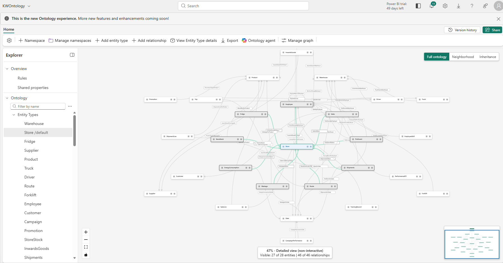

# KW — Microsoft Fabric IQ Workshop

Learn how to turn connected retail data into shared business context for AI with
**Microsoft Fabric IQ**. In this hands-on workshop, you build a data foundation,
model business entities and relationships in an ontology, and compare a
Lakehouse-only data agent with an ontology-grounded agent. The purpose is to explore
how explicit business meaning helps agents interpret questions, navigate
relationships, and explain answers across sales, inventory, logistics, and operations.
Optional live telemetry extends the scenario to cold-chain monitoring.



## Workshop guide

Follow [Instructions.md](./Instructions.md) for the end-to-end workshop, including
Python setup, Fabric ingestion, telemetry, semantic models, ontology rules,
agents, and demonstration exercises.

The workshop is available under the [MIT License](./LICENSE).
Keep local environment files and credentials out of source control; use the
supplied environment templates for configuration.

The workshop is based on a fictional Australian supermarket chain - KW - covering 8 capital cities, 22 stores, 8 state DCs -
designed end-to-end for demonstrating **Microsoft Fabric** — Lakehouse, Eventhouse,
Real-Time Intelligence, Power BI semantic models, and **Fabric IQ** (ontology /
agent layer).

> Every dataset, schema, notebook, and producer in this pack is self-contained.
> No real customer data is used.

---

## What's in the box

```
KW/
├── data/                              # 25 interlinked CSVs (~110 MB)
│   ├── stores.csv, warehouses.csv, fridges_freezers.csv
│   ├── products.csv, suppliers.csv, store_stock.csv, promotions.csv
│   ├── inwards_goods.csv, shipments.csv, shipment_lines.csv
│   ├── forklifts.csv, pick_events.csv
│   ├── trucks.csv, drivers.csv, routes.csv, trips.csv
│   ├── sales.csv, sale_lines.csv, customers.csv
│   ├── employees.csv, employee_skills.csv, performance_kpis.csv, training_records.csv
│   ├── campaigns.csv, campaign_performance.csv
│   └── energy_consumption.csv, wastage.csv
├── notebooks/
│   ├── 01_create_schema.ipynb         # builds Delta schema in KWlakehouse
│   ├── 02_ingest_csvs.ipynb           # loads CSVs from Files/ into tables
│   └── 03_build_semantic_model.ipynb  # builds Direct Lake model via semantic-link (recommended)
├── scripts/
│   ├── generate_data.py               # re-roll the entire dataset (seeded)
│   ├── fridge_telemetry_producer.py   # every 5 min → Event Hub
│   ├── truck_telemetry_producer.py    # every 30 min → Event Hub
│   ├── requirements.txt
│   └── .env.example
├── semantic_model/
│   ├── KW_model.tmdl           # full semantic model in TMDL (alternative path)
│   └── build_semantic_model.py        # Tabular Editor wrapper (alternative path)
└── README.md                          # you are here
```

---

## Data model at a glance

**Departments covered**: Stores, Sales, Distribution, Fleet Management, Marketing, HR, IT.

**Star schema** (silver layer):

```
              ┌───────────┐
              │  dim_date │
              └─────┬─────┘
        ┌──────────┼──────────────────────┐
        │          │                      │
   ┌────▼────┐ ┌───▼────────┐    ┌────────▼─────────┐
   │  Sales  │ │ Shipments  │    │ Pick Events      │
   └────┬────┘ └────┬───────┘    └────┬─────────────┘
        │           │                  │
   ┌────▼────────┐  │           ┌──────▼─────────┐
   │ Sale Lines  │  │           │   Warehouse    │
   └────┬────────┘  │           └──────┬─────────┘
        │           │                  │
   ┌────▼───┐  ┌────▼───┐               │
   │Product │  │ Store  │◄──────────────┘
   └────────┘  └────────┘
        ▲           ▲
        │           │
   ┌────┴───┐  ┌────┴────────────┐
   │Supplier│  │ Fridge / Freezer │ ◄─ joins to live Eventhouse stream
   └────────┘  └──────────────────┘
```

**Real-time streams (Eventhouse)**:
- `fridge_telemetry`  — every 5 min per fridge (temperature, humidity, door state)
- `truck_telemetry`   — every 30 min per truck (GPS, speed, cargo temp, ETA)

---

## Install

Follow the [workshop instructions](./Instructions.md) for prerequisites, local setup,
data ingestion, semantic model creation, ontology configuration, and agent setup.
The guide also covers live telemetry, demonstrations, and troubleshooting.
